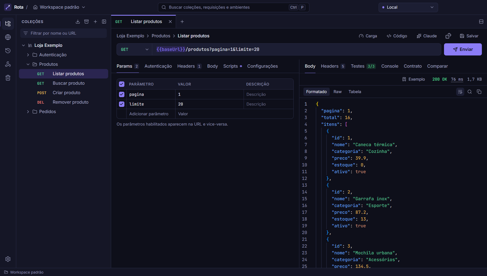
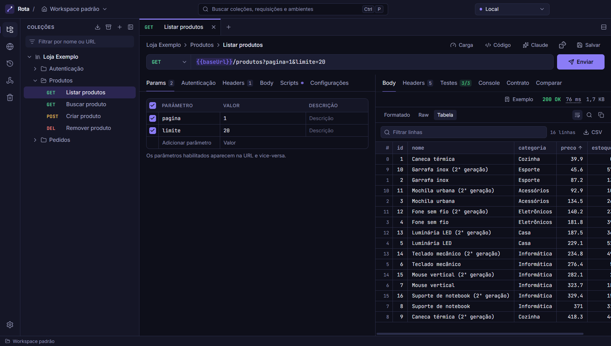
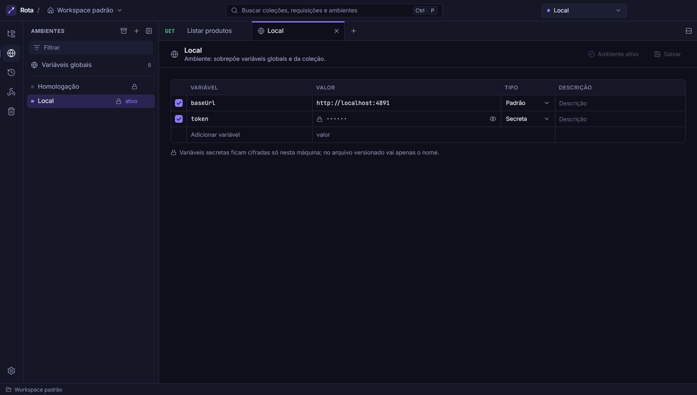
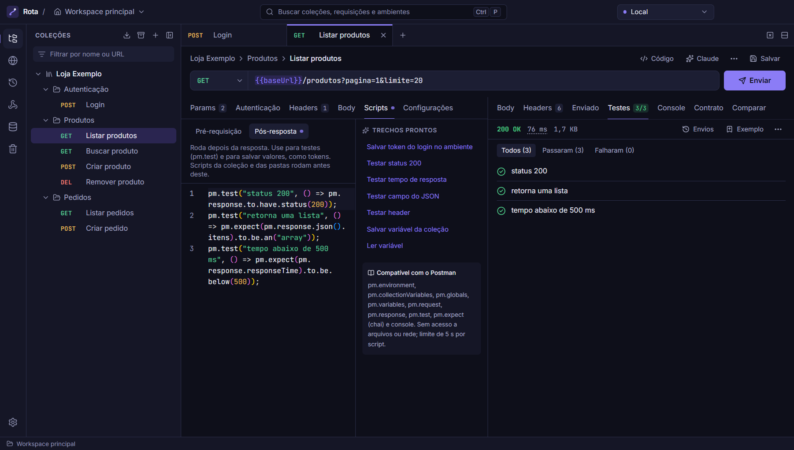
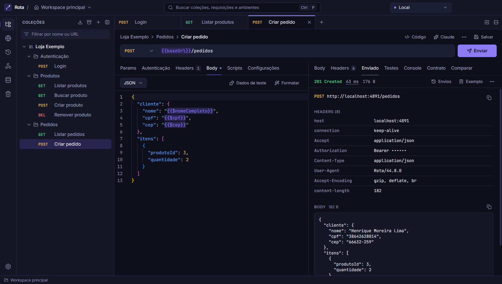
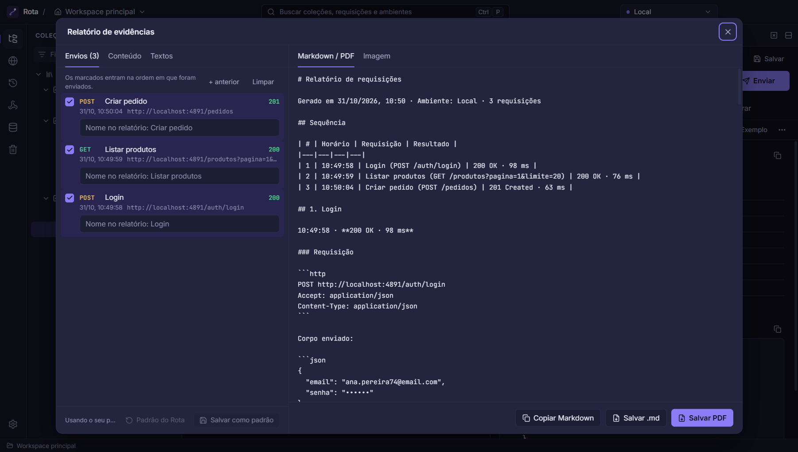
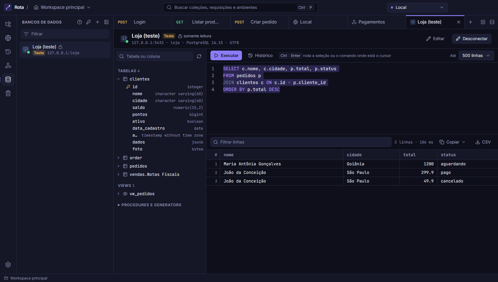
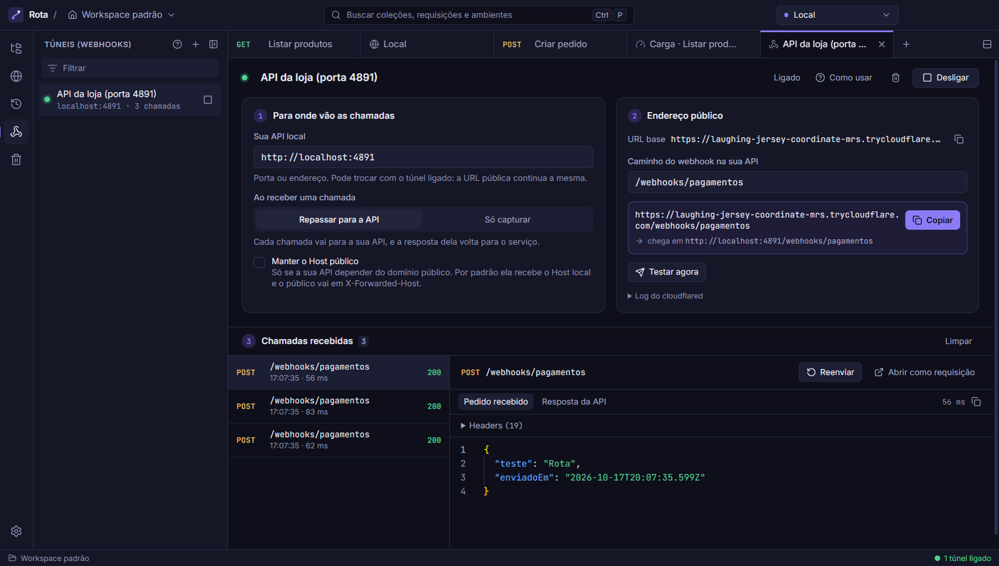
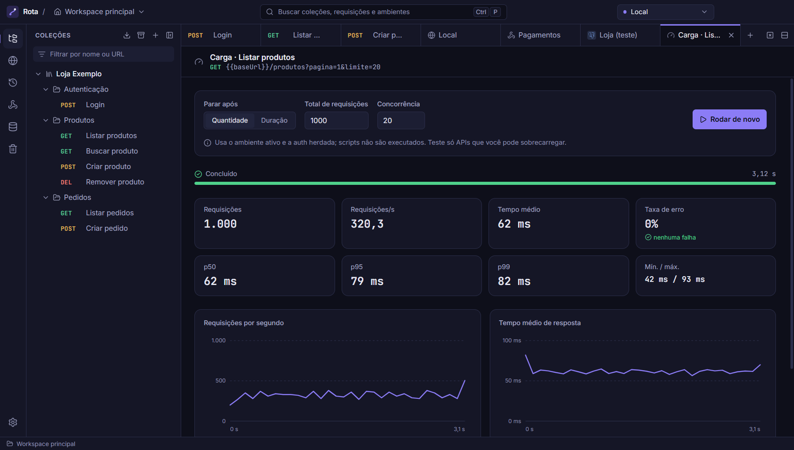

# Rota

Cliente de API para desktop (Windows), no estilo do Postman, que roda offline e se integra ao Claude via MCP. Além das requisições, tem túneis para webhooks, consulta a bancos de dados e relatório de evidências dos testes.



## Principais funcionalidades

### Requisições, variáveis e resposta

- **Requisições HTTP** com params, headers, body (JSON, texto, form-data com arquivos, urlencoded) e auth (Bearer, Basic, API Key) herdada da pasta ou da coleção. Abas fixáveis e várias requisições abertas ao mesmo tempo.
- **Variáveis no padrão do Postman** (globais, da coleção e do ambiente). Passe o mouse numa `{{variável}}` para ver de onde ela vem e editar o valor. No corpo JSON, `{{VAR}}` pode vir sem aspas, como no Postman.
- **Resposta** formatada, em texto puro ou em **tabela** (ordenar, filtrar e exportar CSV no formato do Excel em português). Clique num campo para salvar o valor numa variável.
- **O que foi enviado de verdade**: a aba "Enviado" mostra URL, headers e corpo como saíram na conexão, já com as variáveis resolvidas. A aba Headers lista os headers que o Rota acrescenta sozinho (e deixa desligar cada um).
- **Envios anteriores** de cada requisição a um clique: ver a resposta, restaurar o que foi enviado ou comparar com a atual.



### Ambientes e variáveis secretas

Ambientes como Local, Homologação e Produção, cada um com ícone e cor (o seletor da barra de título fica com a cor do ambiente, um aviso visual de "estou em produção"). **Variáveis secretas** ficam cifradas só na sua máquina: no arquivo do workspace vai apenas o nome, então dá para versionar as coleções no Git sem expor tokens.



### Scripts e testes

Scripts de pré-requisição e pós-resposta compatíveis com o subconjunto mais usado de `pm.*` (`pm.test`, `pm.expect`, `pm.environment`, `pm.response`...), rodando num sandbox QuickJS sem acesso a arquivos ou rede. Coleção e pastas também têm scripts, que rodam antes dos da requisição. Trechos prontos cobrem os casos comuns, como salvar o token do login no ambiente.

**Exemplos e contrato:** salve uma resposta boa como exemplo e, nas próximas, o app avisa se um campo sumiu ou mudou de tipo.



### Dados de teste brasileiros

`{{$cpf}}`, `{{$cnpj}}`, `{{$nomeCompleto}}`, `{{$cep}}`, `{{$celular}}`, `{{$placa}}`, datas e outros geram um valor novo a cada envio (CPF e CNPJ com dígitos válidos). O botão **Dados de teste** do corpo JSON troca nome, CPF, e-mail, telefone, CEP, endereço e valores pelas variáveis certas, com prévia. Na imagem, o corpo com as variáveis e, à direita, o que foi enviado.



### Relatório de evidências

Marque envios do histórico (por exemplo login → consulta → erro) e gere um relatório em **Markdown, PDF ou imagem** para anexar num chamado ou mandar para outro time. Dá para escolher o que entra (headers, corpo, cURL, testes...), renomear cada envio e escrever o contexto. Valores secretos e campos sensíveis (token, senha, autorização) saem como `••••••`.



### Bancos de dados

Conecta em **Firebird (2.5+), PostgreSQL, MySQL/MariaDB e SQL Server** sem instalar cliente. Mostra tabelas, views, colunas e chaves, tem editor SQL com autocomplete (inclusive por alias) e resultado em tabela com filtro, CSV e cópia como JSON, tabela do Excel ou INSERT.

- **Sem decorar SQL**: "Montar" gera SELECT, INSERT, UPDATE e DELETE preenchendo um formulário (com prévia, explicação do que o comando faz e um SELECT para conferir as linhas antes de alterar). Clique direito numa linha do resultado para editar, duplicar ou excluir aquela linha. "Exemplos" traz uma colinha de comandos do banco conectado, com os campos prontos para preencher.
- Conexões de **produção começam somente leitura**: o próprio banco recusa alterações (no SQL Server, que não tem esse recurso, o Rota bloqueia os comandos de escrita).
- Clique direito numa tabela para copiar a estrutura em Markdown, gerar o tipo TypeScript ou **analisar a tabela** (preenchimento, valores distintos, mínimo/máximo e os mais comuns de cada coluna).
- Cole a URL de conexão (`postgresql://...`, JDBC, connection string do .NET) e o formulário se preenche. Uma credencial salva pode ser usada em várias conexões, e as senhas ficam cifradas.
- No Firebird, o charset é detectado sozinho, inclusive em bancos antigos em NONE/WIN1252.



### Túneis e simulador de webhooks

- **Túnel**: cria uma URL `https://….trycloudflare.com` (via cloudflared, gratuito e sem cadastro) que entrega as chamadas na porta da sua API local e registra cada uma para inspecionar e reenviar.
- **Simulador**: dispara eventos de exemplo do Stripe, Mercado Pago, GitHub, Asaas, Shopify, Standard Webhooks (Svix, Clerk, Resend) ou de qualquer serviço com HMAC, **assinados** como o provedor faria, direto na sua API.
- As chamadas recebidas mostram se a assinatura confere com o seu segredo, o que separa "segredo errado" de "código de validação errado". Uma chamada real pode ser salva como evento para repetir depois.



### Teste de carga

Por total de requisições ou duração, com concorrência configurável, percentis (p50, p95, p99), taxa de erro e gráficos de requisições por segundo e tempo de resposta.



### Integração com o Claude (MCP)

O servidor MCP vem embutido no próprio executável. O Claude Desktop ou o Claude Code podem ler e criar coleções, enviar requisições, importar documentação, gerar testes e até organizar a aparência (ícone e cor de coleções, pastas e ambientes), usando o mesmo código do app. Você escolhe o que ele faz direto e o que pede confirmação na tela, e segredos nunca vão para o Claude.

O **pacote de contexto** junta requisições com a resposta, estrutura de tabelas, perfis, webhooks e notas num `.md` para colar no Claude Code, com os valores secretos mascarados.

### Também tem

- **Importação** de Postman (v2.0/v2.1) e OpenAPI 3 / Swagger 2.0 (JSON ou YAML), com prévia e relatório do que não foi suportado.
- **Exportação** para Postman e Markdown, e **backup completo** (todas as coleções, ambientes e globais) num só clique.
- **Gerar código** (cURL, fetch, axios), **colar cURL** na URL e **gerar o tipo** da resposta em TypeScript, Zod ou JSON Schema.
- **Histórico**, **busca global** (Ctrl+P) e **lixeira** com restauração. Excluir, mover ou renomear tem "Desfazer" (Ctrl+Z).
- **Workspaces**: crie quantos quiser (trabalho, pessoal...) e escolha qual abre ao iniciar, ou abra a pasta de um projeto como workspace e versione as coleções junto com o código. Alterações feitas por fora (Git, MCP) aparecem na hora.
- **Aparência**: ícone e cor em coleções, pastas, ambientes e túneis, zoom da interface (Ctrl+= / Ctrl+-), densidade das listas e fonte dos editores.

## Tecnologias

- **Electron 44** + **electron-vite**, **React 19**, **Tailwind CSS 4**, **Zustand**, **Radix UI** e **Monaco Editor**
- **TypeScript** em modo strict, num monorepo com **pnpm workspaces**
- **undici** para as requisições HTTP (no processo principal, sem CORS)
- **QuickJS** (WebAssembly) + **chai** para o sandbox de scripts
- **node-firebird**, **pg**, **mysql2** e **mssql** para os bancos (todos em JavaScript puro, sem cliente instalado)
- **@napi-rs/keyring** para o Windows Credential Manager
- **chokidar** para observar os arquivos do workspace
- **@modelcontextprotocol/sdk** para o servidor MCP
- **Vitest** para testes, **Biome** para lint e formatação, **electron-builder** para o instalador

## Rodando localmente

Requisitos: **Windows 10/11**, **Node.js 22+** e **pnpm 10+** (`corepack enable` instala a versão certa do pnpm).

```sh
git clone https://github.com/Darlan0307/rota-api-client.git
cd rota-api-client
pnpm install
pnpm dev
```

`pnpm dev` abre o app em modo de desenvolvimento (F5 recarrega, F12 abre o DevTools). Na primeira abertura o workspace está vazio: importe uma coleção do Postman pelo ícone de download na barra de coleções ou crie uma do zero.

Outros comandos:

```sh
pnpm test        # testes de todos os pacotes (Vitest)
pnpm typecheck   # checagem de tipos
pnpm lint        # lint e formatação (Biome)
pnpm format      # aplica as correções automáticas do Biome
pnpm build       # build de produção do app e do servidor MCP
```

Os testes de integração com bancos de verdade sobem containers Docker com dados fictícios e são pulados quando as variáveis não estão definidas:

```sh
node packages/core/scripts/firebird/setup.mjs     # Firebird 2.5 na porta 3051
node packages/core/scripts/databases/setup.mjs    # PostgreSQL 5433, MySQL 3307, SQL Server 14330
ROTA_FIREBIRD_TEST=127.0.0.1:3051 ROTA_PG_TEST=127.0.0.1:5433 ROTA_MYSQL_TEST=127.0.0.1:3307 ROTA_MSSQL_TEST=127.0.0.1:14330 pnpm test
```

### Gerar o instalador

```sh
pnpm --filter @rota/desktop dist       # instalador NSIS em apps/desktop/release/Rota-Setup-<versão>.exe
pnpm --filter @rota/desktop dist:dir   # só o app empacotado, sem instalador (release/win-unpacked)
```

O instalador não tem assinatura digital, então o Windows mostra "O Windows protegeu o computador". Clique em **Mais informações → Executar assim mesmo**. A instalação é por usuário e não pede administrador. Os dados ficam em `%APPDATA%\Rota` e são mantidos ao atualizar ou desinstalar.

Fechar a janela encerra tudo (túneis, conexões de banco, servidor MCP, vigia de arquivos); nada fica rodando em segundo plano.

### Conectar ao Claude (MCP)

No app, abra **Configurações → Claude (MCP)**:

- **Claude Desktop:** "Configurar automaticamente" inclui o Rota no `claude_desktop_config.json` (guardando uma cópia do arquivo anterior). Reinicie o Claude Desktop depois.
- **Claude Code:** copie o comando `claude mcp add rota ...` mostrado na tela.

Ao abrir, o app verifica uma vez se o servidor inicia e onde ele está configurado; o resultado aparece na barra de status ("MCP pronto") e em detalhe nessa mesma tela.

O servidor roda com o próprio `Rota.exe` em modo Node, sem precisar de Node instalado. Em **Configurações → Claude (MCP) → Confirmações** você escolhe o que o Claude faz direto e o que pede confirmação no app: organizar, editar, excluir e enviar DELETE/PUT/PATCH (por padrão, organizar e editar passam direto). Esvaziar a lixeira, teste de carga e enviar valores secretos para um endereço que você ainda não usou sempre pedem. No diálogo, "Não perguntar de novo" libera aquele tipo de ação até fechar o app. Quem libera é o app: com ele fechado, o Claude só lê e cria; organizar, editar, excluir e enviar DELETE/PUT/PATCH são recusados.

## Variáveis de ambiente

O app não precisa de nenhuma variável para rodar. Existe uma opcional, útil em desenvolvimento:

| Variável | Para que serve |
|---|---|
| `ROTA_DATA_DIR` | Pasta de dados alternativa (padrão: `%APPDATA%\Rota`). Permite testar sem mexer nas suas coleções reais. |

Ela é lida do ambiente do processo, não de um arquivo `.env`. No PowerShell:

```powershell
$env:ROTA_DATA_DIR = "C:\temp\rota-dev"; pnpm dev
```

O [`.env.example`](.env.example) documenta a mesma variável.

## Estrutura

```
apps/
  desktop/        app Electron
    src/main/       processo principal: IPC e serviços (workspace, requisições, túneis,
                    bancos, teste de carga, MCP)
    src/preload/    ponte mínima entre main e renderer
    src/renderer/   interface React (features/, layout/, components/, state/)
    src/shared/     contrato IPC tipado entre main e renderer
  mcp/            servidor MCP (empacotado com esbuild dentro do app)
packages/
  core/           lógica compartilhada entre app e MCP, sem Electron:
                  modelo, armazenamento, variáveis e dados de teste, HTTP, scripts,
                  importação/exportação, histórico, lixeira, segredos, teste de carga,
                  túneis, webhooks, bancos de dados, evidências e ponte com o MCP
docs/
  screenshots/
```

O app e o servidor MCP usam o mesmo `@rota/core`, então o Claude faz exatamente o que o app faria.

## Próximos passos

- OAuth 2.0 com renovação automática do token (client credentials, password, authorization code + PKCE)
- Rodar uma coleção ou pasta inteira em sequência (como o Collection Runner do Postman)
- Mock server a partir dos exemplos salvos
- WebSocket, SSE e GraphQL nativo (hoje o GraphQL importado do Postman vira um corpo JSON)
- Assinatura digital e atualização automática do instalador
- Versões para macOS e Linux (caminhos e comunicação entre processos já tratam os três sistemas; faltam o empacotamento, o cofre de segredos e o download do cloudflared de cada um)

## Licença

[MIT](LICENSE)
