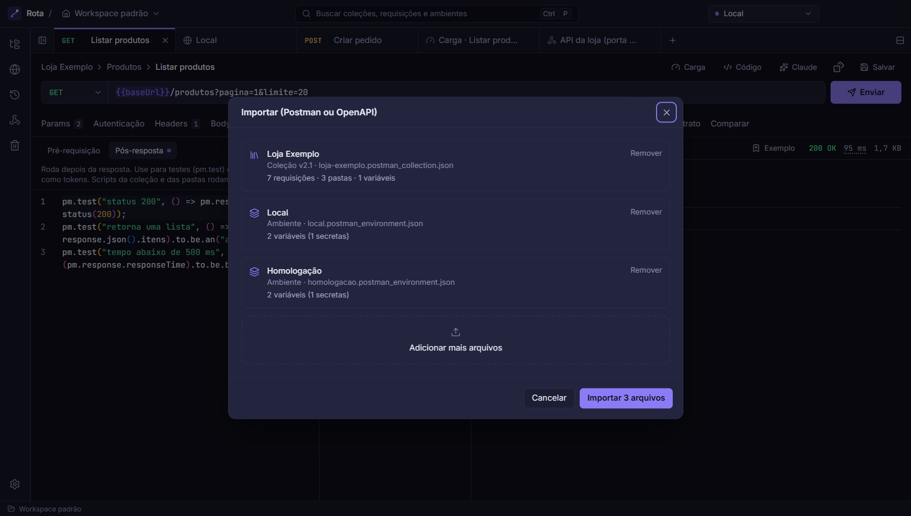
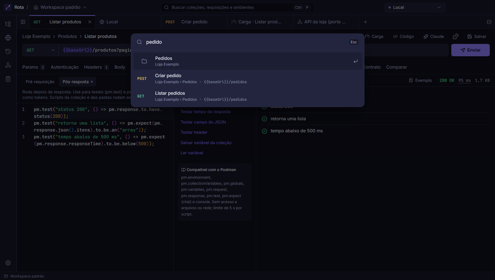

# Rota

Cliente de API para desktop (Windows), no estilo do Postman, que roda offline e se integra ao Claude via MCP.


## Funcionalidades

- **Requisições HTTP** com params, headers, body (JSON, texto, form-data com arquivos, urlencoded), auth (Bearer, Basic, API Key) herdada de pasta ou coleção, e várias abas abertas.
- **Variáveis no padrão do Postman** (global, coleção e ambiente), com destaque e, ao passar o mouse, o valor para ver e editar (o olho revela as secretas), e **variáveis secretas** cifradas fora do workspace. No corpo JSON, `{{VAR}}` pode vir sem aspas, como no Postman.
- **Scripts de pré-requisição e pós-resposta** compatíveis com o subconjunto mais usado de `pm.*` (`pm.test`, `pm.expect`, `pm.environment`, `pm.response`...), rodando num sandbox QuickJS sem acesso a arquivos ou rede.
- **Resposta** formatada, em texto puro ou em **tabela** (ordenar, filtrar, exportar CSV). Clique num campo e salve o valor numa variável.
- **Exemplos e contrato**: salve uma resposta boa como exemplo; nas próximas, o app avisa se um campo sumiu ou mudou de tipo. Também dá para comparar com um envio anterior.
- **Dados de teste brasileiros**: `{{$cpf}}`, `{{$cnpj}}`, `{{$nomeCompleto}}`, `{{$cep}}`, `{{$celular}}`, `{{$placa}}`... geram um valor novo a cada envio (CPF e CNPJ com dígitos válidos).
- **Importação** de Postman (v2.0/v2.1) e OpenAPI 3 / Swagger 2.0 (JSON ou YAML), com prévia e relatório do que não foi suportado.
- **Exportação** para Postman e Markdown, e **backup completo** (todas as coleções, ambientes e globais) num só clique.
- **Histórico**, **busca global** (Ctrl+P), **gerar código** (cURL, fetch, axios), **colar cURL** na URL e **lixeira** com restauração. Excluir, mover ou renomear tem "Desfazer" (Ctrl+Z).
- **Teste de carga** simples: total de requisições ou duração, concorrência, percentis e gráficos.
- **Túneis para webhooks**: cria uma URL `https://….trycloudflare.com` (via cloudflared) que entrega as chamadas na porta da sua API local e registra cada chamada para inspecionar e reenviar.
- **Simulador de webhooks**: dispara eventos de exemplo do Stripe, Mercado Pago, GitHub, Asaas, Shopify, Standard Webhooks (Svix, Clerk, Resend) ou de qualquer serviço com HMAC, com a assinatura correta, direto na sua API. As chamadas reais recebidas pelo túnel mostram se a assinatura confere com o seu segredo.
- **Bancos de dados**: conecta em Firebird (2.5+), PostgreSQL, MySQL/MariaDB e SQL Server sem instalar cliente. Mostra tabelas, views, colunas e chaves, tem editor SQL com autocomplete (inclusive por alias) e resultado em tabela com filtro e CSV. No Firebird detecta o charset sozinho (inclusive bancos antigos em NONE/WIN1252). Conexões de produção começam somente leitura: o próprio banco recusa alterações (no SQL Server, que não tem esse recurso, o Rota bloqueia os comandos de escrita). Credenciais salvas servem para vários clientes com a mesma senha.
- **Workspaces**: crie quantos quiser (trabalho, pessoal...) e escolha qual abre ao iniciar, ou abra qualquer pasta como workspace e versione as coleções junto com o código. Alterações feitas por fora (Git, MCP) aparecem na hora.
- **Servidor MCP** embutido no próprio executável, com configuração automática do Claude Desktop e comando pronto para o Claude Code.

## Screenshots

| | |
|---|---|
|  <br> Resposta em tabela, com ordenação e exportação CSV |  <br> Scripts `pm.*` e resultado dos testes |
|  <br> Ambientes com variáveis secretas |  <br> Dados de teste gerados a cada envio |
|  <br> Prévia da importação do Postman |  <br> Busca global (Ctrl+P) |
|  <br> Teste de carga |  <br> Túnel recebendo webhooks |

## Tecnologias

- **Electron 44** + **electron-vite**, **React 19**, **Tailwind CSS 4**, **Zustand**, **Radix UI** e **Monaco Editor**
- **TypeScript** em modo strict, num monorepo com **pnpm workspaces**
- **undici** para as requisições HTTP (no processo principal, sem CORS)
- **QuickJS** (WebAssembly) + **chai** para o sandbox de scripts
- **@napi-rs/keyring** para o Windows Credential Manager
- **chokidar** para observar os arquivos do workspace
- **@modelcontextprotocol/sdk** para o servidor MCP
- **Vitest** para testes, **Biome** para lint e formatação, **electron-builder** para o instalador

## Rodando localmente

Requisitos: **Windows 10/11**, **Node.js 22+** e **pnpm 10+** (`corepack enable` instala a versão certa do pnpm).

```sh
git clone https://github.com/Darlan0307/rota-api-client.git
cd rota-api-client
pnpm install
pnpm dev
```

`pnpm dev` abre o app em modo de desenvolvimento (F5 recarrega, F12 abre o DevTools). Na primeira abertura o workspace está vazio: importe uma coleção do Postman pelo ícone de download na barra de coleções ou crie uma do zero.

Outros comandos:

```sh
pnpm test        # testes de todos os pacotes (Vitest)
pnpm typecheck   # checagem de tipos
pnpm lint        # lint e formatação (Biome)
pnpm format      # aplica as correções automáticas do Biome
pnpm build       # build de produção do app e do servidor MCP
```

### Gerar o instalador

```sh
pnpm --filter @rota/desktop dist       # instalador NSIS em apps/desktop/release/Rota-Setup-<versão>.exe
pnpm --filter @rota/desktop dist:dir   # só o app empacotado, sem instalador (release/win-unpacked)
```

O instalador não tem assinatura digital, então o Windows mostra "O Windows protegeu o computador". Clique em **Mais informações → Executar assim mesmo**. A instalação é por usuário e não pede administrador. Os dados ficam em `%APPDATA%\Rota` e são mantidos ao atualizar ou desinstalar.

Fechar a janela encerra tudo (túneis, conexões, vigia de arquivos); nada fica rodando em segundo plano.

### Conectar ao Claude (MCP)

No app, abra **Configurações → Claude (MCP)**:

- **Claude Desktop:** "Configurar automaticamente" inclui o Rota no `claude_desktop_config.json` (guardando uma cópia do arquivo anterior). Reinicie o Claude Desktop depois.
- **Claude Code:** copie o comando `claude mcp add rota ...` mostrado na tela.

Ao abrir, o app verifica uma vez se o servidor inicia e onde ele está configurado; o resultado aparece na barra de status ("MCP pronto") e em detalhe nessa mesma tela.

O servidor roda com o próprio `Rota.exe` em modo Node, sem precisar de Node instalado. Ações que alteram ou apagam dados, requisições DELETE/PUT/PATCH e o envio de valores secretos para um endereço que você ainda não usou pedem confirmação no app; com o app fechado, elas são recusadas.

## Variáveis de ambiente

O app não precisa de nenhuma variável para rodar. Existe uma opcional, útil em desenvolvimento:

| Variável | Para que serve |
|---|---|
| `ROTA_DATA_DIR` | Pasta de dados alternativa (padrão: `%APPDATA%\Rota`). Permite testar sem mexer nas suas coleções reais. |

Ela é lida do ambiente do processo, não de um arquivo `.env`. No PowerShell:

```powershell
$env:ROTA_DATA_DIR = "C:\temp\rota-dev"; pnpm dev
```

O [`.env.example`](.env.example) documenta a mesma variável.

## Estrutura

```
apps/
  desktop/        app Electron
    src/main/       processo principal: IPC, serviços (requisições, túneis, MCP, workspace)
    src/preload/    ponte mínima entre main e renderer
    src/renderer/   interface React (features/, layout/, components/, state/)
  mcp/            servidor MCP (empacotado com esbuild dentro do app)
packages/
  core/           lógica compartilhada entre app e MCP: modelo, armazenamento,
                  variáveis, HTTP, scripts, importação/exportação, histórico,
                  lixeira, teste de carga e túneis
docs/
  DECISOES.md     decisões técnicas e de produto, com o motivo de cada uma
  screenshots/
```

O app e o servidor MCP usam o mesmo `@rota/core`, então o Claude faz exatamente o que o app faria.

## Próximos passos

- Rodar uma coleção inteira em sequência (como o Collection Runner do Postman)
- Suporte a WebSocket e GraphQL
- Assinatura digital e atualização automática do instalador
- Versões para macOS e Linux (caminhos e comunicação entre processos já tratam os três sistemas; faltam o empacotamento, o cofre de segredos e o download do cloudflared de cada um)

## Licença

[MIT](LICENSE)
